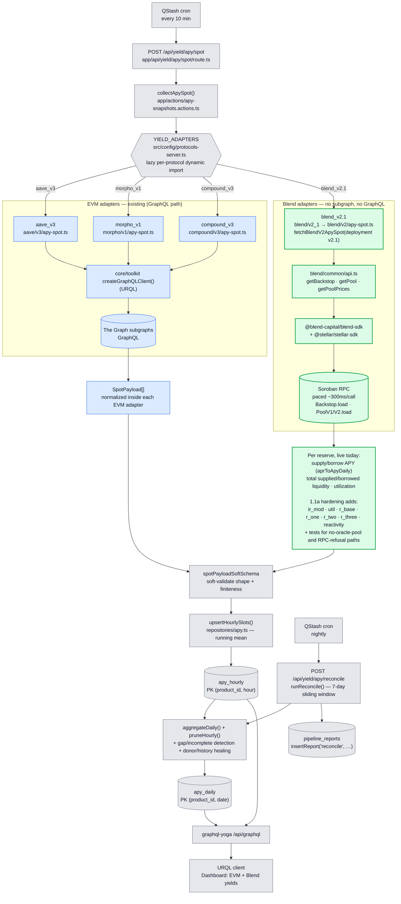
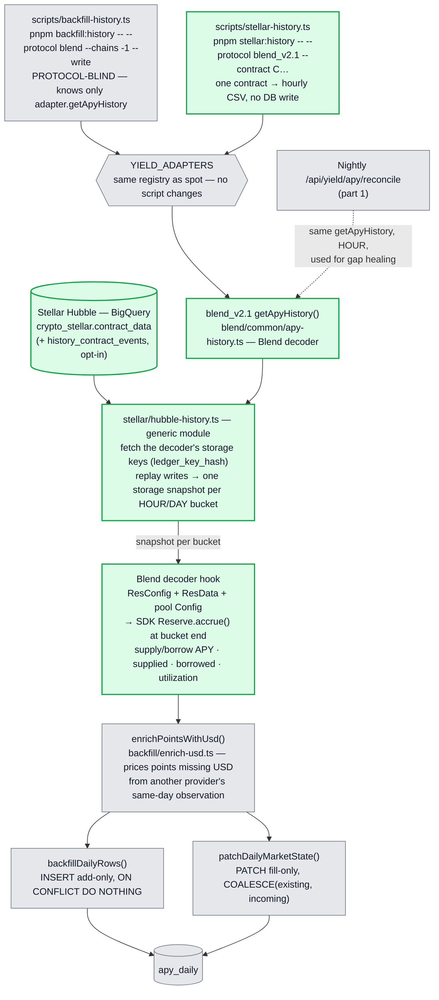
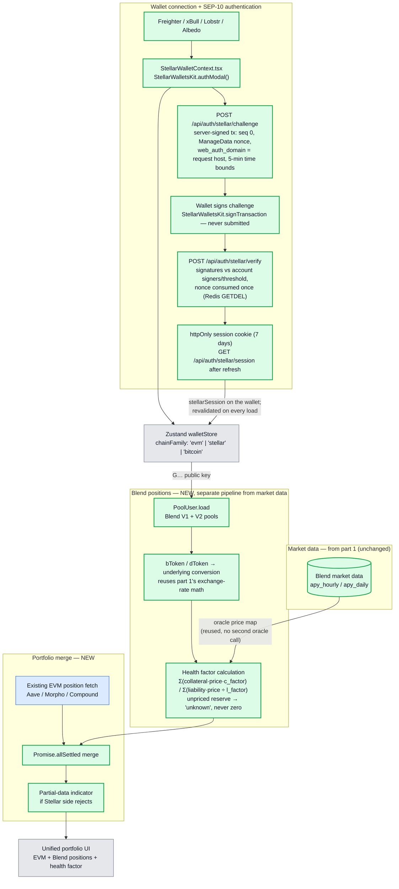
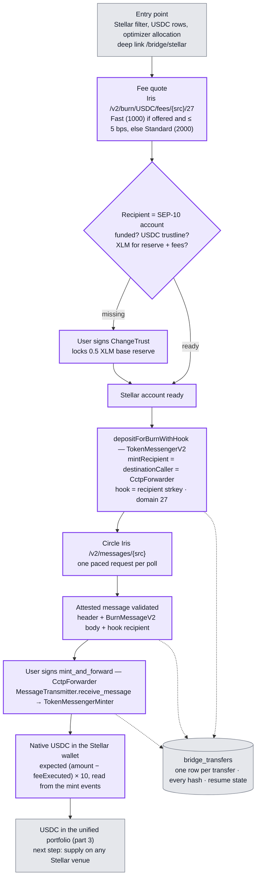
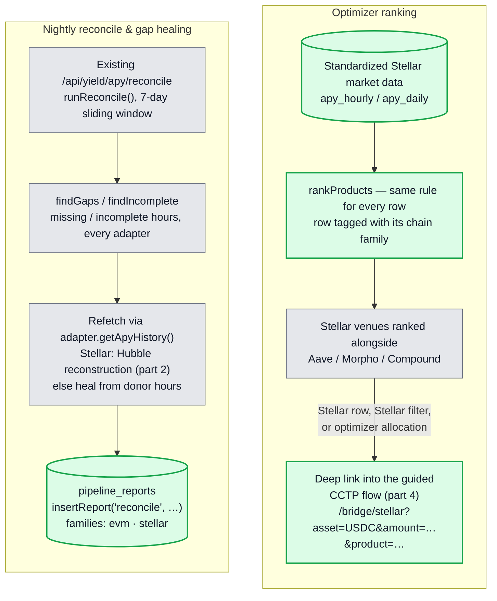
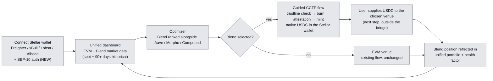

# LendWise — Stellar Cross-Chain Integration Architecture

> **Scope** — the Stellar integration validated in the Stellar Community Fund #45 submission,
> structured around five parts: Blend spot market data, Blend historical data via Stellar Hubble,
> Stellar wallet + SEP-10 auth + Blend positions + health factor + unified portfolio, CCTP
> execution from EVM into a Stellar wallet, and optimizer ranking + monitoring.
>
> **Legend** — green = NEW bricks added for Stellar ·
> blue = existing EVM pipeline (unchanged) · grey = shared core (unchanged) ·
> purple = cross-chain execution (CCTP).

The integration spans five parts, matching the submission's tranche structure:

1. **Blend spot market data** — live rates and reserve parameters from Blend v2.1 (v1/v2 retired).
2. **Blend historical data** — reserve-state reconstruction from Stellar Hubble.
3. **Wallet, auth & portfolio** — SEP-10, Blend position reads, health factor, unified portfolio.
4. **CCTP execution** — native USDC from an EVM chain into the user's Stellar wallet, ready for
   any Stellar venue.
5. **Optimizer & monitoring** — Blend ranked as a venue, nightly gap detection and healing.

---

## 1. Blend spot market data

**Reading the diagram** — matches the code as implemented, not a future design.

- The trigger, registry, `apy_hourly`/`apy_daily`, the nightly reconcile job, and the GraphQL
  serving layer are **shared and unchanged** — protocol-agnostic by design. `YIELD_ADAPTERS` in
  `src/config/protocols-server.ts` is the actual registry: a plain record of lazy dynamic imports
  keyed by protocol id (`aave_v3`, `morpho_v1`, `compound_v3`, `blend_v2.1`).
  `collectApySpot()` calls `getApySpot()` on every registered id via `Promise.allSettled`.
- Existing EVM protocols read through **The Graph subgraphs** via `createGraphQLClient()`.
- **Blend has no subgraph**, so `blend_v2.1` bypasses GraphQL entirely, reading **Soroban
  contracts** through the **Blend SDK** via `blend/common/api.ts`, which serializes every RPC
  read behind a ~300ms pacing queue to stay under Soroban RPC's rate limit.
- **Blend deployments, not versions** (`blend/common/deployments.ts`). v2.1 runs the very same
  pool contract as v2 (same wasm, storage layout and SDK classes) behind its own backstop and
  factory, so `blend_v2.1` reuses v2's code with its own catalogue (`version` = `v2.1`). The pool
  set is the `products` catalogue ∪ the backstop's reward zone ∪ the factory's `Deploy` events
  of the last ~7 days (`blend/listing.ts`); the reward zone is what catalogues a pool older than
  the RPC's event window. **`blend_v1` and `blend_v2` are retired** — every pool of both is frozen
  or on ice since the exploit: unregistered from the three registries, their code kept, their
  rows and history kept, their availability periods closed by `scripts/retire-products.ts`.
  This is the same uniform `<protocol>/<version>/apy-spot.ts` layout every EVM adapter already
  follows (`aave/v3/`, `morpho/v1/`, `compound/v3/`) — not a Blend-specific exception.
- **Already live:** supply/borrow APY, total supplied/borrowed liquidity, and utilization per
  reserve. **Not yet captured — this is 1.1a's hardening deliverable:** the interest rate modifier
  (`ir_mod`) and rate parameters (`util`, `r_base`, `r_one`, `r_two`, `r_three`, `reactivity`),
  plus test coverage for the no-oracle-pool and RPC-refusal failure paths already handled in code.
- Each adapter — EVM or Blend — returns `SpotPayload[]` **already normalized internally**; there is
  no separate shared normalization stage. `collectApySpot()` only soft-validates
  (`spotPayloadSoftSchema`) and upserts via `upsertHourlySlots()`.
- There is no separate daily cron: a single **nightly `/api/yield/apy/reconcile`** job
  (`runReconcile()`, 7-day sliding window) detects gaps/incomplete hours, heals them from donor
  products or via `adapter.getApyHistory()`, aggregates `apy_hourly` into `apy_daily`, prunes old
  hourly rows, and logs one row per run into `pipeline_reports`.

---

## 2. Blend historical data — Stellar Hubble reconstruction

**Reading the diagram**

- Blend has **no subgraph and no history API** of its own, so history is **reconstructed from
  Stellar Hubble**, the public BigQuery mirror of the ledger.
- **Two halves.** `src/lib/protocols/stellar/hubble-history.ts` is protocol-blind: it queries
  `contract_data` for exactly the storage keys a decoder names (matched on `ledger_key_hash` =
  sha256 of the `LedgerKey` XDR, the formula stellar-etl uses), seeds each key with its last value
  before the window, replays every later write, and hands the decoder one storage snapshot per
  complete HOUR or DAY bucket. A Stellar adapter supplies only the decoder
  (`StellarHistoryDecoder`: `contractId`, `ledgerKeys`, `decode`) and gets `getApyHistory` from it.
- **Blend's decoder recomputes rates the way the SDK does.** Rates are not stored on-chain; the
  pool stores their inputs. The decoder parses `ResConfig(asset)`, `ResData(asset)` and the pool
  `Config` (backstop take rate) with the SDK's own parsers, accrues the reserve to the bucket's end
  with `Reserve.accrue()`, and applies the same APR→APY split as `apy-spot.ts` — so a backfilled
  hour and a collected hour are computed identically. A test pins this against real mainnet
  storage for a v1 and a v2 pool (`blend/common/__tests__/fixtures/`).
- **Pools On Ice / Frozen still reconstruct.** Their storage is intact and still accrues; status
  only blocks new actions.
- **Not reconstructed:** BLND emissions (`rewards` = 0) and USD amounts (filled downstream by
  `enrichPointsWithUsd`, or left NULL).
- **Cost guard.** The seed scan reaches back to Blend's launch (2024-05), and `contract_data` is
  clustered on `last_modified_ledger` first, so the `contract_id` filter prunes little. Every job
  carries `maximumBytesBilled` (`HUBBLE_MAX_BYTES_BILLED`, default 20 GiB); over it, BigQuery
  refuses and the products are reported as failures — the reconcile job then heals from donors.
  `pnpm stellar:history -- … --dry-run` prices a window without running it.
- **Callers.** The backfill harness and the nightly reconcile job call `getApyHistory()` unchanged —
  Stellar's internal chain id is `-1`, so the backfill needs `--chains -1`. The pool, asset and
  storage version come from the meta Blend writes at `getProducts` time (`poolId`, `assetId`,
  `version`), never from parsing the productId.

---

## 3. Wallet, SEP-10 auth, Blend positions, health factor & unified portfolio

**Reading the diagram**

- **Auth (top) — SEP-10 on top of the wallet connection.** `StellarWalletContext.tsx` connects
  **Freighter, xBull, Lobstr and Albedo** via `StellarWalletsKit.authModal()`, then runs the
  **SEP-10** round trip (`src/lib/auth/stellar-sep10.ts`): the server issues a challenge signed by
  `STELLAR_SEP10_SIGNING_SECRET` and bound to the host the request reached (`<host> auth` +
  `web_auth_domain`), the client checks it is a genuine challenge for this address, this network
  and the page's own host before asking the wallet to sign it, and the server verifies the signatures against the
  account's signers and medium threshold (any extra signature is rejected) before setting an
  httpOnly session cookie. Challenges are single-use and sessions revocable through Upstash Redis,
  which is therefore required in production. After a refresh, a persisted Stellar wallet counts as
  connected only if `/api/auth/stellar/session` still validates its cookie.
- **Mainnet only.** Server and wallet both use the SDK's `Networks.PUBLIC`, like the Blend
  adapters — there is no network setting to get wrong. The client refuses a challenge for any
  other passphrase before signing, and a session cookie from another network is not a session.
- **Market data vs. positions are two distinct pipelines.** Market data (part 1/2) describes what
  a Blend pool as a whole offers; positions describe what one authenticated wallet holds in it.
  Blend positions are **never** written into `apy_hourly`/`apy_daily` or the nightly cron —
  `PoolUser.load` is a per-user, on-demand read, resolved to a single direct ledger-entry read.
- **Conversion reuses part 1's math.** Blend's bToken/dToken share units convert to underlying
  amounts with the same exchange-rate logic already built for reserve totals in the spot adapter —
  this is a new caller of that logic, not new conversion logic.
- **Health factor reuses the oracle price map** already fetched per-pool in the spot pipeline, so
  computing it costs no second round of oracle calls. An unpriced reserve fails the calculation
  **closed** — shown as "unknown" in the UI — rather than valuing that collateral at zero.
- **Merge is `Promise.allSettled`, not custom logic.** A rejected Stellar-side promise renders the
  EVM side with a partial-data indicator instead of blanking the dashboard — this is
  `allSettled`'s native behavior.

---

## 4. CCTP execution — EVM → Stellar

**Reading the diagram**

- **Order is load-bearing: trustline check before burn, not after.** Stellar requires an explicit
  trustline before an account can hold any non-native asset, including SEP-41-wrapped USDC — a
  mint to an account without one fails at the ledger level, and that failure only surfaces after
  the source-chain burn has already been attested. The preflight (`src/lib/execution/cctp/trustline.ts`)
  gates the burn button.
- **The forwarder step is not optional.** Stellar's account model can't receive an arbitrary
  contract's mint the way an EVM address receives an ERC-20 `mint(to, amount)` call, so
  `mintRecipient` is routed to the `CctpForwarder` contract (with `destinationCaller` also set to
  it) — routing it to the end-user's address directly makes the funds permanently unrecoverable,
  per Circle's own documentation. The burn is planned on the server from per-network constants
  (`src/lib/execution/cctp/config.ts`, `burn.ts`); the browser only signs it.
- **Decimals are rescaled in the transfer logic**: 6 on EVM and in the CCTP message, 7 on
  Stellar. The amount received is read from the mint transaction's events and stored.
- **Fast Transfer is the default finality tier**, since Stellar's own ~5-second finality means the
  attestation wait dominates total transfer time regardless of tier choice. The tier follows the
  live fee quote (`fees.ts`).
- **Nothing is minted on an unchecked message.** The attested message is parsed and every field is
  checked against the plan before the mint is prepared (`message.ts`): source and destination
  domains, `TokenMessengerMinter` as header recipient, the forwarder as destination caller and
  mint recipient, amount, fee, sender, and the hook recipient = the signed-in Stellar account.
  The sender is the burn's `depositor` from the `DepositForBurn` event (`evm-receipt.ts`), not the
  transaction's `from`, so a burn sent through a smart account validates too.
- **The user signs everything.** ChangeTrust and `mint_and_forward` are prepared by the server,
  signed in the user's Stellar wallet and validated before relay; approve and burn are signed in
  the EVM wallet. A signed ChangeTrust must carry the maximum trustline limit. No LendWise key, no
  relayer.
- **Auditable and resumable.** Every step writes its transaction hash to `bridge_transfers` from
  the server; the row is unique per owner (`source_domain`, `burn_tx_hash`, `stellar_address`).
  The same row is the resume state: a transfer interrupted after the burn is resumed from the
  bridge page, never burned twice. A mint left pending is marked failed once the mint
  transaction's 300-second validity plus 30 seconds has passed (`service.ts`).
- **Protocol-independent.** The flow ends with native USDC in the wallet and in the unified
  portfolio. Supplying it to Blend — or to any venue integrated through the adapter contract — is
  the user's next step; the bridge holds no protocol code.
- **Testnet mode.** One switch per deployment (`NEXT_PUBLIC_NETWORK`,
  `src/config/stellar-network.ts`) moves SEP-10, the wallet kit, Horizon, Soroban RPC, the CCTP
  contracts, Iris and the EVM chains to testnet. Every preview runs on testnet unless the variable
  says `mainnet` (testnet.lendwise.fi is the testnet staging); production is always mainnet.

---

## 5. Optimizer & monitoring

**Reading the diagram**

- **Optimizer:** the ranking rule is unchanged — rates from any registered Stellar adapter flow
  into the same `apy_hourly`/`apy_daily` tables every other protocol uses. `src/lib/products/ranking.ts`
  ranks every row by the same rule and tags it with its chain family; the family never changes the
  rank, only what the row's bridge link pre-fills (next bullet). Covered in CI against a fixture
  Stellar adapter (`stellar_fixture`), so any Stellar venue registered through the adapter
  contract is ranked with no further engineering.
- **Entry points:** the Stellar network filter shows a "Bridge USDC to Stellar" banner, and an
  optimizer allocation on a Stellar venue links to the bridge with the allocated amount. Every
  USDC row, Stellar or EVM, shows a "Bridge to Stellar" action next to its protocol link
  (`ProductRowActions`, `bridgeActionFor`); the protocol link stays. On a Stellar USDC row the
  bridge link carries `product=<productId>`, so the flow can name the venue as the next step. On
  an EVM USDC row of a supported CCTP source chain it carries `source=<chain>`; on any other EVM
  row it carries no source rather than a silent default. Links come from one builder
  (`bridgeHref`).
- **Monitoring:** `runReconcile()` behind `/api/yield/apy/reconcile` runs generically across every
  registered adapter, over a 7-day sliding window (`RECONCILE_WINDOW_DAYS`). `blend_v2.1` heals
  missing hours through its Hubble-backed `getApyHistory()` (part 2). Each nightly report in
  `pipeline_reports` has a `families` section — adapters, gaps detected, hours repaired by
  refetch or from neighbours, history calls — so the Stellar family shows in the same health
  checks as the EVM protocols. `scripts/reconcile-status.ts` prints it.

---

## 6. End-to-end cross-chain user journey

This is the guided flow the submission promises: **connect → compare → optimize → execute**, with
Stellar venues ranked next to EVM markets and native USDC reachable directly from an EVM wallet
via CCTP — with no DEX swap, third-party bridge, or fiat on-ramp step in the path. The bridge ends
with USDC in the user's Stellar wallet; the deposit into the chosen venue is the user's next step.

---

## 7. New vs existing — at a glance

| Brick                              | Status             | Library / path                                                                                                              |
| :--------------------------------- | :----------------- | :-------------------------------------------------------------------------------------------------------------------------- |
| Adapter registry                   | existing           | `YIELD_ADAPTERS` — `src/config/protocols-server.ts`                                                                         |
| Spot collection                    | existing           | `collectApySpot()` — `app/actions/apy-snapshots.actions.ts`                                                                 |
| EVM lending data                   | existing           | The Graph subgraphs via `createGraphQLClient()` (URQL)                                                                      |
| `apy_hourly` / `apy_daily`         | existing           | `repositories/apy.ts` + Drizzle schema                                                                                      |
| Nightly reconcile (aggregate/heal) | existing           | `/api/yield/apy/reconcile` — `runReconcile()`, 7-day sliding window                                                         |
| GraphQL serving                    | existing           | `graphql-yoga` `/api/graphql`                                                                                               |
| Existing EVM position fetch        | existing           | portfolio data-fetch layer                                                                                                  |
| Existing optimizer ranking engine  | existing           | optimizer module, unchanged                                                                                                 |
| Blend V1 spot adapter              | retired            | `src/lib/protocols/blend/v1/apy-spot.ts` — unregistered, pools frozen                                                       |
| Blend V2 spot adapter              | retired            | `src/lib/protocols/blend/v2/apy-spot.ts` — code reused by v2.1                                                              |
| Blend v2.1 adapter                 | **shipped**        | `src/lib/protocols/blend/v2_1/` — v2 code, v2.1 backstop (`blend/common/deployments.ts`)                                    |
| Blend data source                  | **shipped**        | `@blend-capital/blend-sdk` + `@stellar/stellar-sdk` over Soroban RPC                                                        |
| Stellar wallet connection          | **shipped**        | `StellarWalletContext.tsx` — Freighter / xBull / Lobstr / Albedo                                                            |
| `chainFamily` store field          | **shipped**        | `src/stores/walletStore.ts`                                                                                                 |
| **Blend rate-parameter fields**    | **NEW (1.1a)**     | `ir_mod` / `util` / `r_base` / `r_one` / `r_two` / `r_three` / `reactivity` + failure-path tests                            |
| Blend historical adapter           | **shipped**        | `blend/common/apy-history.ts` (decoder) — `getApyHistory()` on `blend_v2.1`                                                 |
| Stellar Hubble reconstruction      | **shipped**        | `stellar/hubble-history.ts`; consumed by `backfill-history.ts`, reconcile, `stellar-history.ts`                             |
| SEP-10 authentication              | **shipped**        | `/api/auth/stellar/{challenge,verify,session}` + `lib/auth/stellar-sep10.ts` + client signing flow                          |
| Blend position reads               | **shipped (2.1a)** | `src/lib/protocols/blend/v2_1/positions.ts` — `PoolUser.load` + bToken/dToken conversion                                    |
| Health factor calculation          | **shipped (2.1b)** | `src/lib/risk/` — per-reserve collateral/liability factors, reused oracle price map                                         |
| Portfolio merge                    | **shipped (2.2b)** | `src/lib/portfolio/load.ts` — `Promise.allSettled` + partial-data indicator                                                 |
| Stellar network switch             | **shipped (3.1)**  | `src/config/stellar-network.ts` — mainnet in production, testnet on a dedicated staging                                     |
| CCTP trustline check & ChangeTrust | **shipped (3.1b)** | `src/lib/execution/cctp/trustline.ts`                                                                                       |
| CCTP burn (EVM) + forwarder mint   | **shipped (3.1a)** | `src/lib/execution/cctp/{config,amounts,hook,burn,message,mint}.ts` — Circle CCTP V2 + Stellar Soroban contracts            |
| CCTP attestation → native USDC     | **shipped (3.1c)** | `src/lib/execution/cctp/iris.ts` (paced Iris client) + `service.ts`, `bridge_transfers` audit table, `/bridge/stellar` flow |
| Optimizer ranking surfacing        | **shipped (3.2a)** | `src/lib/products/ranking.ts` + deep link `bridgeHref` into the CCTP flow                                                   |
| Monitoring / gap-heal extension    | **shipped (3.2b)** | `families` section of the reconcile report in `pipeline_reports`; Stellar fixture adapter on staging                        |
