# SCF #45 — Milestone 3 (Tranche 3, Mainnet)

Evidence for the six Tranche 3 deliverables of LendWise's
[Stellar Community Fund #45 submission](https://communityfund.stellar.org/submissions/recmK8tdxCKvSU3GS)
(Tranche 3, "Mainnet", $41,810): each success criterion, and where to check it — in this public
repository, on the testnet staging environment, and on [lendwise.fi](https://lendwise.fi).

| Deliverable                                                                                                      | Success criterion                                                                                                                                                                                                 | Status    |
| ---------------------------------------------------------------------------------------------------------------- | ----------------------------------------------------------------------------------------------------------------------------------------------------------------------------------------------------------------- | --------- |
| [1 — Core CCTP burn + forwarder-routed mint](#1--core-cctp-burn--forwarder-routed-mint) ($10,170)                | Testnet and mainnet transaction hashes showing USDC minted on Stellar in the correct amount, on Stellar Expert                                                                                                    | Delivered |
| [2 — Trustline detection & ChangeTrust prompt](#2--trustline-detection--changetrust-prompt) ($3,390)             | With a fresh Stellar wallet with no USDC trustline, the app prompts to create one before the transfer, and the transfer completes                                                                                 | Delivered |
| [3 — Attestation polling & end-to-end flow](#3--attestation-polling--end-to-end-evm--stellar-flow) ($13,560)     | A reviewer completes a full testnet run themselves — EVM testnet wallet to native USDC in their Stellar testnet wallet and LendWise portfolio — with a hash for every step; a mainnet hash as supporting evidence | Delivered |
| [4 — Optimizer ranking surfacing](#4--optimizer-ranking-surfacing) ($4,520)                                      | On lendwise.fi, the Stellar filter or a USDC row reaches the guided bridge with the destination pre-filled; chain-family-aware ranking covered in CI against a fixture Stellar adapter                            | Delivered |
| [5 — Production monitoring & gap-heal extension](#5--production-monitoring--gap-heal-extension) ($3,390)         | The Stellar adapter family in the same health checks as the other protocols, with gap detection and the Hubble refetch path exercised against a fixture Stellar adapter on staging                                | Delivered |
| [6 — Public integration docs & final hardening pass](#6--public-integration-docs--final-hardening-pass) ($6,780) | Integration documentation published at a public URL; manual QA of the live mainnet path for a first-time and a returning user                                                                                     | Delivered |

**Environments.**

| Environment                                        | Network                                                                    | Purpose                                                        |
| -------------------------------------------------- | -------------------------------------------------------------------------- | -------------------------------------------------------------- |
| [testnet.lendwise.fi](https://testnet.lendwise.fi) | Stellar testnet · Sepolia, Base Sepolia, Arbitrum Sepolia · Circle sandbox | Reviewer testnet runs (branch `testnet`)                       |
| [mainnet.lendwise.fi](https://mainnet.lendwise.fi) | Stellar mainnet · Ethereum, Base, Arbitrum, Optimism                       | Pre-production of the `mainnet` branch, first mainnet transfer |
| [lendwise.fi](https://lendwise.fi)                 | Stellar mainnet · Ethereum, Base, Arbitrum, Optimism                       | Production (branch `main`): bridge, entry points, QA           |

Market data is mainnet on every site: the testnet switch only moves the bridge, the Stellar
sign-in and the Stellar wallet.

**CI:** the latest green run on `main`,
[run 39336969857](https://github.com/lendwise-fi/lendwise/actions/runs/39336969857), commit
`813b471`, the release the QA below ran on.

**Architecture:** [Stellar integration architecture, part 4](architecture-stellar-integration.md#4-cctp-execution--evm--stellar)
and the public [CCTP bridge architecture](https://lendwise.fi/docs/integrate/cctp-bridge).

**Transfer records:** every transfer below is a row of the `bridge_transfers` table, written by
the server at each step. The full notes, including how each one was checked against the chains,
are in [`scf-45/t3-transfers.md`](scf-45/t3-transfers.md).

---

## 1 — Core CCTP burn + forwarder-routed mint

> **Success criteria:** A reviewer is given a real testnet and mainnet transaction hashes showing
> USDC minted on Stellar in the correct amount, clickable on a Stellar block explorer (e.g.
> Stellar Expert).

### What was built

| Proposal item                                                                                                                                                    | Where                                                                                                                                                                                                           |
| ---------------------------------------------------------------------------------------------------------------------------------------------------------------- | --------------------------------------------------------------------------------------------------------------------------------------------------------------------------------------------------------------- |
| **EVM burn** with Circle CCTP V2 `depositForBurnWithHook`, `mintRecipient` = `destinationCaller` = `CctpForwarder`, domain 27                                    | [`src/lib/execution/cctp/burn.ts`](../src/lib/execution/cctp/burn.ts), hook data in [`hook.ts`](../src/lib/execution/cctp/hook.ts), per-network constants in [`config.ts`](../src/lib/execution/cctp/config.ts) |
| **Stellar contracts**: `mint_and_forward` on `cctp-forwarder`, already-received check on `message-transmitter`, `token-messenger-minter` as the header recipient | [`src/lib/execution/cctp/mint.ts`](../src/lib/execution/cctp/mint.ts), [`message.ts`](../src/lib/execution/cctp/message.ts)                                                                                     |
| **7-vs-6 decimals in the transfer logic**                                                                                                                        | [`src/lib/execution/cctp/amounts.ts`](../src/lib/execution/cctp/amounts.ts); the received amount is read from the mint events and stored                                                                        |
| **Attested message validated** before any mint (header, `BurnMessageV2` body, hook recipient)                                                                    | `assertExpectedMessage` in [`message.ts`](../src/lib/execution/cctp/message.ts)                                                                                                                                 |

### Transfers

Expected received amount: `(amount − feeExecuted) × 10` Stellar units (7 decimals). USDC has 6
decimals on the EVM side and 7 on Stellar.

| Network | Where               | Source chain | Amount | Fee executed | Expected received | Received | Burn                                                                                                              | Mint                                                                                                                     |
| ------- | ------------------- | ------------ | ------ | ------------ | ----------------- | -------- | ----------------------------------------------------------------------------------------------------------------- | ------------------------------------------------------------------------------------------------------------------------ |
| Testnet | testnet.lendwise.fi | Base Sepolia | 2 USDC | 0.00026 USDC | 1.99974 USDC      | 1.99974  | [0x615f306d…](https://sepolia.basescan.org/tx/0x615f306d86302c3925d525ef3e2aa53a6f9309d3f29db739c42dd3f9a5f9cac7) | [3fac8bcc…](https://stellar.expert/explorer/testnet/tx/3fac8bccbb096613558290dbfb7fdee46cfb8629c9c5d6a4fd3f66d1ed6f264e) |
| Testnet | testnet.lendwise.fi | Sepolia      | 1 USDC | 0.0001 USDC  | 0.9999 USDC       | 0.9999   | [0xc4993bf4…](https://sepolia.etherscan.io/tx/0xc4993bf48d2d353bb75327b2b337a7913978381fb43a2847bbe9ab04320f3ee3) | [8ca47b9f…](https://stellar.expert/explorer/testnet/tx/8ca47b9fcf8934c1955efbbffe668bcea5e46e59b35983ade89e012a8dab2cd5) |
| Mainnet | mainnet.lendwise.fi | Base         | 5 USDC | 0.00065 USDC | 4.99935 USDC      | 4.99935  | [0x42878875…](https://basescan.org/tx/0x428788758cde10c635110abfc8c84fb800d76a8995254f73a0922a90c1945ac0)         | [64717907…](https://stellar.expert/explorer/public/tx/64717907a20683eca1b62b8852252a02cb43caadbbdb71a73613e5e692266d50)  |
| Mainnet | lendwise.fi (QA)    | Base         | 5 USDC | 0.00065 USDC | 4.99935 USDC      | 4.99935  | [0x21deba50…](https://basescan.org/tx/0x21deba50dfd285d1dcad86e798a9bc95d4bd70074da224b3a52c7745dba7e506)         | [14cd5da6…](https://stellar.expert/explorer/public/tx/14cd5da6b70d8a1f078a1fe05b949f3e288d0ebab0553bffbe23996c9396fbf0)  |
| Mainnet | lendwise.fi (QA)    | Base         | 4 USDC | 0.00052 USDC | 3.99948 USDC      | 3.99948  | [0x2e3be76a…](https://basescan.org/tx/0x2e3be76ab76e4544adb7046962d64825e9ea53c45bf71477268b73fc5d30d9ac)         | [a6e39a07…](https://stellar.expert/explorer/public/tx/a6e39a07754dd1cdccc2d0a6428f9efdad787bbc25c6dc6651962c57aa563154)  |

On Stellar Expert, each mint transaction calls `mint_and_forward` on the forwarder
(`CA66Q2WFBND6V4UEB7RD4SAXSVIWMD6RA4X3U32ELVFGXV5PJK4T4VSZ` on testnet,
`CBZL2IH7F6BIDAA3WBNXYKIXSATJGMSW7K5P5MJ6STX5RXN47TZJDF5T` on mainnet) and transfers the USDC to
the recipient account. All five are Fast transfers (finality threshold 1000).

### Tests (CI)

| Test file                                                                                                     | What it pins                                                                                                                         |
| ------------------------------------------------------------------------------------------------------------- | ------------------------------------------------------------------------------------------------------------------------------------ |
| [`execution/cctp/__tests__/amounts.test.ts`](../src/lib/execution/cctp/__tests__/amounts.test.ts)             | 6 → 7 decimals; strict parsing (no locale comma, no seventh decimal, no zero); formatting                                            |
| [`execution/cctp/__tests__/hook.test.ts`](../src/lib/execution/cctp/__tests__/hook.test.ts)                   | Hook data in Circle's layout, round trip, non-Stellar recipient refused                                                              |
| [`execution/cctp/__tests__/burn.test.ts`](../src/lib/execution/cctp/__tests__/burn.test.ts)                   | Forwarder as `mintRecipient` and `destinationCaller`, domain 27; the other network's contracts refused                               |
| [`execution/cctp/__tests__/message.test.ts`](../src/lib/execution/cctp/__tests__/message.test.ts)             | Header and `BurnMessageV2` body at Circle's offsets; a message that differs from the plan, or forwards elsewhere, refused            |
| [`execution/cctp/__tests__/testnet-mints.test.ts`](../src/lib/execution/cctp/__tests__/testnet-mints.test.ts) | **Real testnet Iris messages**: every field read as Iris decodes it, the hook our burn builds, received amount `(amount − fee) × 10` |
| [`execution/cctp/__tests__/mint.test.ts`](../src/lib/execution/cctp/__tests__/mint.test.ts)                   | `mint_and_forward` built and simulated for the session account; signed mint validated before relay; fee bid floor and cap            |

---

## 2 — Trustline detection & ChangeTrust prompt

> **Success criteria:** Using any fresh Stellar wallet with no USDC trustline, the app prompts to
> create one before the transfer, and the transfer completes right after — a reviewer can test this
> themselves with a new wallet.

### What was built

| Proposal item                                                                                                                     | Where                                                                                                                         |
| --------------------------------------------------------------------------------------------------------------------------------- | ----------------------------------------------------------------------------------------------------------------------------- |
| **Pre-flight** of the recipient account's ledger entries before the burn (funded, trustline, available XLM, limit, authorization) | `preflightFromAccount` in [`src/lib/execution/cctp/trustline.ts`](../src/lib/execution/cctp/trustline.ts)                     |
| **ChangeTrust prompt**, built on the server, signed in the wallet, validated before relay                                         | `buildChangeTrustXdr`, `assertSignedChangeTrust` in the same file; UI in [`src/components/bridge/`](../src/components/bridge) |
| **Sequencing**: the burn stays disabled until the account is `ready`                                                              | [`src/lib/execution/cctp/service.ts`](../src/lib/execution/cctp/service.ts) (`createBridgeTransfer` re-runs the preflight)    |

### Demonstration

Fresh testnet wallet
[`GBGGQPLRYAPGBA7JKNOWSQQVDCV23M6UBUWVULBBOZ6GPR4U5UE2BYL7`](https://stellar.expert/explorer/testnet/account/GBGGQPLRYAPGBA7JKNOWSQQVDCV23M6UBUWVULBBOZ6GPR4U5UE2BYL7):
the account did not exist yet, so the bridge offered Friendbot, then asked for the USDC trustline
before anything was signed on the EVM side.

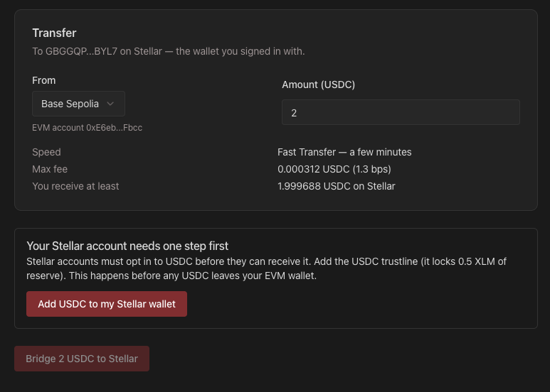

| Step        | Transaction                                                                                                              |
| ----------- | ------------------------------------------------------------------------------------------------------------------------ |
| ChangeTrust | [0f8e65b0…](https://stellar.expert/explorer/testnet/tx/0f8e65b0990d0e24098e6bc9d3e42d11d1723b1fb1b1a9d94ff5cf1ad3a7a2b2) |
| Burn        | [0x615f306d…](https://sepolia.basescan.org/tx/0x615f306d86302c3925d525ef3e2aa53a6f9309d3f29db739c42dd3f9a5f9cac7)        |
| Mint        | [3fac8bcc…](https://stellar.expert/explorer/testnet/tx/3fac8bccbb096613558290dbfb7fdee46cfb8629c9c5d6a4fd3f66d1ed6f264e) |

The same path on mainnet, with a fresh account on lendwise.fi, is in the
[QA log](#mainnet-qa-on-lendwisefi).

### Tests (CI)

| Test file                                                                                             | What it pins                                                                                                                                                            |
| ----------------------------------------------------------------------------------------------------- | ----------------------------------------------------------------------------------------------------------------------------------------------------------------------- |
| [`execution/cctp/__tests__/trustline.test.ts`](../src/lib/execution/cctp/__tests__/trustline.test.ts) | Every preflight state (account missing, trustline missing, XLM for the reserve first, another issuer's USDC, unauthorized line, fee margin); signed ChangeTrust checked |

---

## 3 — Attestation polling & end-to-end EVM → Stellar flow

> **Success criteria:** A reviewer can complete one full run themselves on testnet — send USDC
> from an EVM testnet wallet and see it arrive as native USDC in their Stellar testnet wallet, and
> in their LendWise portfolio, within a few minutes, with a transaction hash for every step. A
> completed mainnet transaction hash is also provided as supporting evidence.

### What was built

| Proposal item                                                                                       | Where                                                                                                                                                                                                   |
| --------------------------------------------------------------------------------------------------- | ------------------------------------------------------------------------------------------------------------------------------------------------------------------------------------------------------- |
| **Iris polling client** on the paced-request pattern of the Soroban RPC integration                 | [`src/lib/execution/cctp/iris.ts`](../src/lib/execution/cctp/iris.ts) on [`src/lib/net/paced-queue.ts`](../src/lib/net/paced-queue.ts), the queue Blend's `pacedRpc` now runs on                        |
| **Fast Transfer by default**, from the live fee quote                                               | [`src/lib/execution/cctp/fees.ts`](../src/lib/execution/cctp/fees.ts)                                                                                                                                   |
| **Guided flow**: source chain and amount, preflight, burn, live attestation status, mint, portfolio | [`/bridge/stellar`](<../src/app/(dashboard)/bridge/stellar/page.tsx>), [`src/components/bridge/`](../src/components/bridge), server actions [`bridge.actions.ts`](../src/app/actions/bridge.actions.ts) |
| **Protocol-independent**: ends with native USDC; any venue links in through `product=`              | [`src/lib/execution/cctp/deep-link.ts`](../src/lib/execution/cctp/deep-link.ts)                                                                                                                         |
| **Hash logging at every step**, resumable                                                           | `bridge_transfers` table ([`schema.ts`](../src/lib/db/schema.ts), [`bridge-transfers.ts`](../src/lib/db/repositories/bridge-transfers.ts))                                                              |
| **Testnet mode** on a staging environment                                                           | [`src/config/stellar-network.ts`](../src/config/stellar-network.ts)                                                                                                                                     |

### Reviewer walkthrough on testnet

1. Install a Stellar wallet extension (Freighter or xBull), create an account and **switch it to
   Testnet**. You do not need to fund it: the bridge offers Friendbot when the account does not
   exist yet.
2. Get testnet USDC on Base Sepolia (or Sepolia, Arbitrum Sepolia) from
   [Circle's faucet](https://faucet.circle.com), and a little testnet ETH for gas on the same
   chain.
3. Open [testnet.lendwise.fi/bridge/stellar?asset=USDC](https://testnet.lendwise.fi/bridge/stellar?asset=USDC).
   The header shows a **Testnet** badge.
4. Connect the EVM wallet, then **Sign in with Stellar** (sign the SEP-10 challenge).
5. Choose the source chain and an amount (at least 1 USDC). A fresh account is asked to add the
   USDC trustline first — sign it.
6. Approve, burn, wait for the attestation (about a minute on Fast), sign the mint. Every step
   shows its transaction hash with an explorer link. You can reload the page at any point: the
   transfer is listed with **Resume**.
7. Click **View in portfolio**: the USDC is in the **Wallet balances** tab.

The team's run of the same walkthrough (transfer 1 above):

| Step        | Transaction                                                                                                              |
| ----------- | ------------------------------------------------------------------------------------------------------------------------ |
| ChangeTrust | [0f8e65b0…](https://stellar.expert/explorer/testnet/tx/0f8e65b0990d0e24098e6bc9d3e42d11d1723b1fb1b1a9d94ff5cf1ad3a7a2b2) |
| Approval    | [0x48cc8991…](https://sepolia.basescan.org/tx/0x48cc8991af041e921a7395f3c9e7ea2a7a7e2c9f3c8c5608b34e5285312b7bf3)        |
| Burn        | [0x615f306d…](https://sepolia.basescan.org/tx/0x615f306d86302c3925d525ef3e2aa53a6f9309d3f29db739c42dd3f9a5f9cac7)        |
| Attestation | Iris nonce `0x9940a61369186f276da544634e764c8c665872e32f3e6c67dbe2b8af5c20a583`, attested at finality 1000 (Fast)        |
| Mint        | [3fac8bcc…](https://stellar.expert/explorer/testnet/tx/3fac8bccbb096613558290dbfb7fdee46cfb8629c9c5d6a4fd3f66d1ed6f264e) |
| Total time  | 2 min 27 s from burn to mint, including a page reload to test **Resume**                                                 |

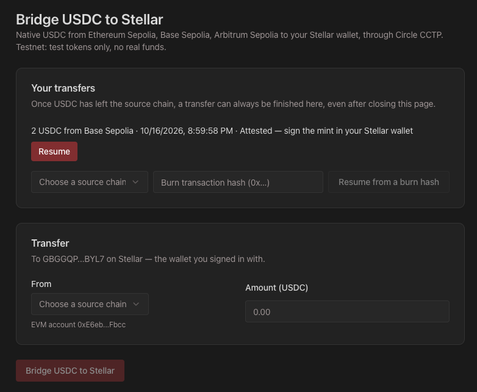

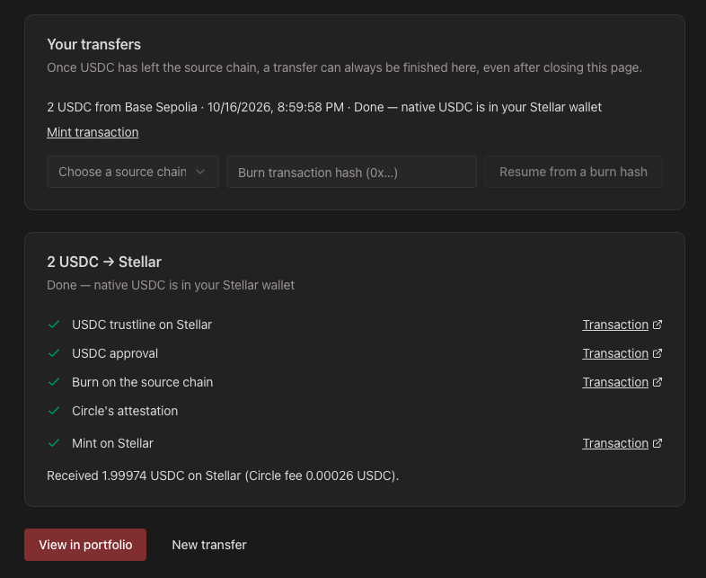

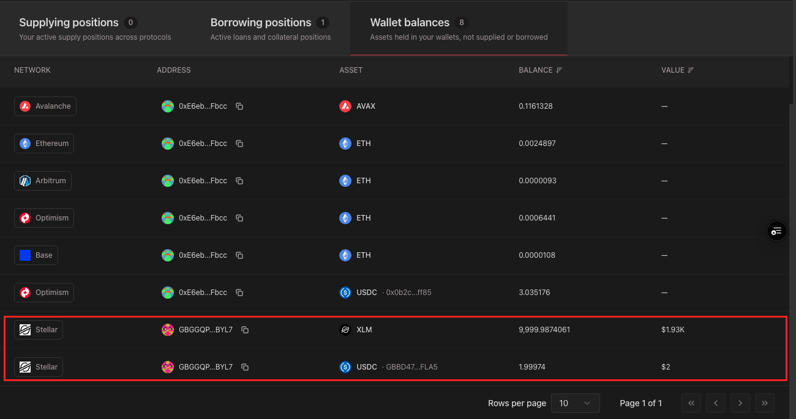

### Mainnet run

On [mainnet.lendwise.fi](https://mainnet.lendwise.fi), the pre-production, before the bridge was
opened on lendwise.fi: 5 USDC from Base.

| Step        | Transaction                                                                                                             |
| ----------- | ----------------------------------------------------------------------------------------------------------------------- |
| Approval    | [0x824c1955…](https://basescan.org/tx/0x824c1955d45e0e69509ea666b7dafcb91dda4a38a9fbbb8097242507d8af1b35)               |
| Burn        | [0x42878875…](https://basescan.org/tx/0x428788758cde10c635110abfc8c84fb800d76a8995254f73a0922a90c1945ac0)               |
| Attestation | Iris nonce `0x6d3dde0ae1b660c0866036be4b0976757ab807b5a2e7aee97acbfbd96bc68b0a`, attested at finality 1000 (Fast)       |
| Mint        | [64717907…](https://stellar.expert/explorer/public/tx/64717907a20683eca1b62b8852252a02cb43caadbbdb71a73613e5e692266d50) |

The RPC provider answered the first two mint submissions with HTTP 500. Since PR #44, the server
resends the same signed transaction through the network's public Soroban RPC when the provider
gives no answer; the third mint went through it. Details in
[`scf-45/t3-transfers.md`](scf-45/t3-transfers.md#transfer-3-mainnet). The two transfers of the
[mainnet QA](#mainnet-qa-on-lendwisefi) on lendwise.fi minted on the first signature.

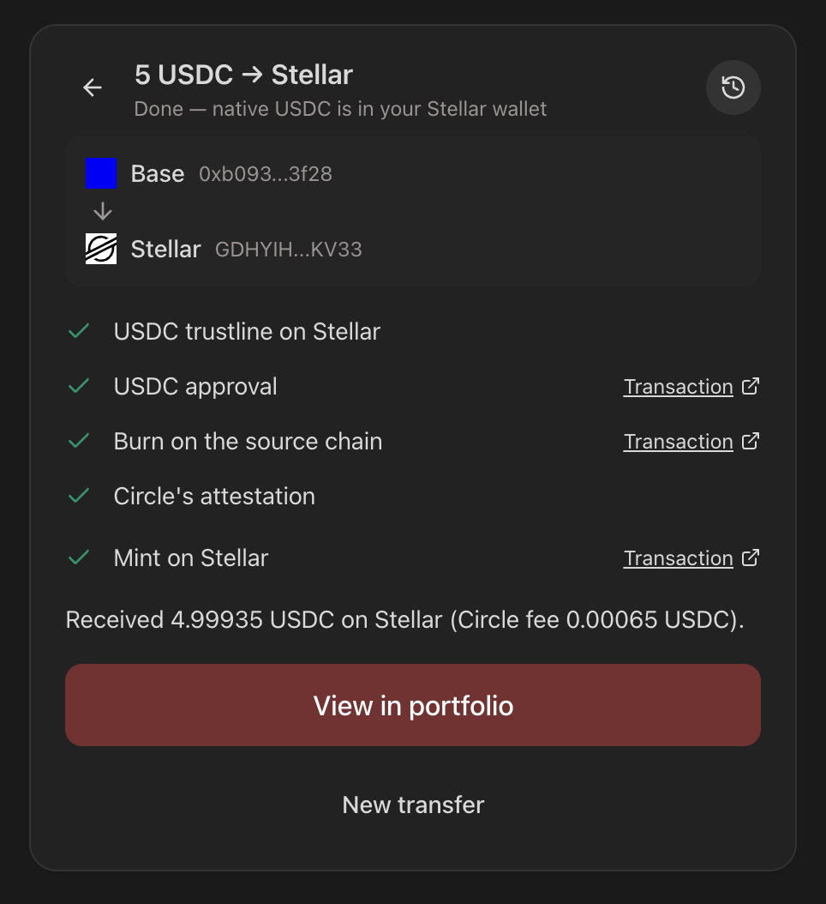

### Tests (CI)

| Test file                                                                                                 | What it pins                                                                                                                                  |
| --------------------------------------------------------------------------------------------------------- | --------------------------------------------------------------------------------------------------------------------------------------------- |
| [`net/paced-queue.test.ts`](../src/lib/net/paced-queue.test.ts)                                           | Minimum interval between call starts, submission order kept, a rejection does not stall the queue, bounded length                             |
| [`execution/cctp/__tests__/iris.test.ts`](../src/lib/execution/cctp/__tests__/iris.test.ts)               | Not indexed yet, pending confirmations and 429 reported as pending; message, attestation and nonce once complete                              |
| [`execution/cctp/__tests__/fees.test.ts`](../src/lib/execution/cctp/__tests__/fees.test.ts)               | Fast with a 20 % buffer, rounded up; Standard above the ceiling or when Fast is not offered                                                   |
| [`execution/cctp/__tests__/evm-receipt.test.ts`](../src/lib/execution/cctp/__tests__/evm-receipt.test.ts) | Burn confirmed by its `DepositForBurn` event and depositor (relayed smart-account burns included); reverted or foreign-contract burns refused |
| [`execution/cctp/service.test.ts`](../src/lib/execution/cctp/service.test.ts)                             | The flow's transitions; trustline required before any row; mainnet cap enforced server-side; resume and imports                               |

---

## 4 — Optimizer ranking surfacing

> **Success criteria:** On lendwise.fi, a reviewer filtering the comparison tables on Stellar, or
> opening a USDC row, reaches the guided bridge flow with the destination pre-filled through the
> deep link. The chain-family-aware ranking is covered by tests passing in CI against a fixture
> Stellar adapter, so any Stellar venue registered through the adapter contract is ranked next to
> Aave/Morpho/Compound with no further engineering.

### What was built

| Proposal item                                                                                           | Where                                                                                                                               |
| ------------------------------------------------------------------------------------------------------- | ----------------------------------------------------------------------------------------------------------------------------------- |
| **Chain-family-aware ranking**: one rule for every row, each row tagged with its family and entry point | [`src/lib/products/ranking.ts`](../src/lib/products/ranking.ts)                                                                     |
| **Fixture Stellar adapter** (yield side), through the adapter contract, never in production             | [`src/lib/protocols/stellar/fixture/yield.ts`](../src/lib/protocols/stellar/fixture/yield.ts)                                       |
| **Entry points**: Stellar filter banner, USDC row action, optimizer allocation                          | [`src/components/products/`](../src/components/products), [`src/lib/products/bridge-entry.ts`](../src/lib/products/bridge-entry.ts) |
| **Deep link** with asset, amount, source and product                                                    | `bridgeHref` in [`src/lib/execution/cctp/deep-link.ts`](../src/lib/execution/cctp/deep-link.ts)                                     |

### On lendwise.fi

1. Open [lendwise.fi](https://lendwise.fi), Supply table, network filter **Stellar**: a "Bridge
   USDC to Stellar" banner leads to the bridge.
2. On any USDC row, the **Bridge to Stellar** action (⇆) opens the bridge with USDC, and with the
   source chain when the row is on Ethereum, Base, Arbitrum or Optimism.
3. In the Supply optimizer, an allocation on a Stellar USDC venue offers **Bridge <amount> USDC to
   Stellar**, with the amount pre-filled.
4. The destination is the Stellar account you are signed in with.

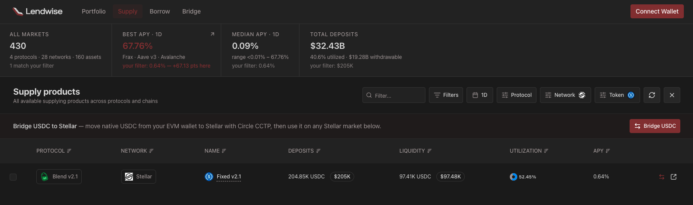

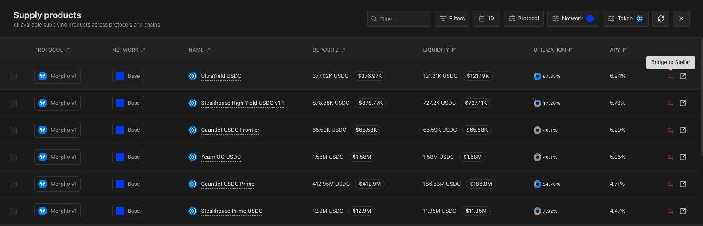

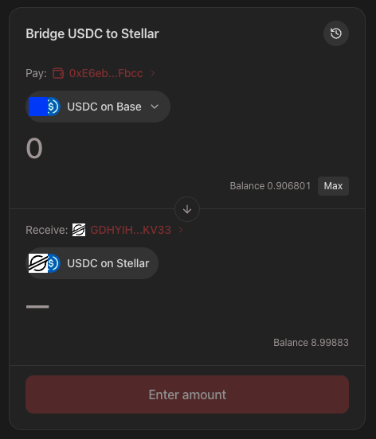

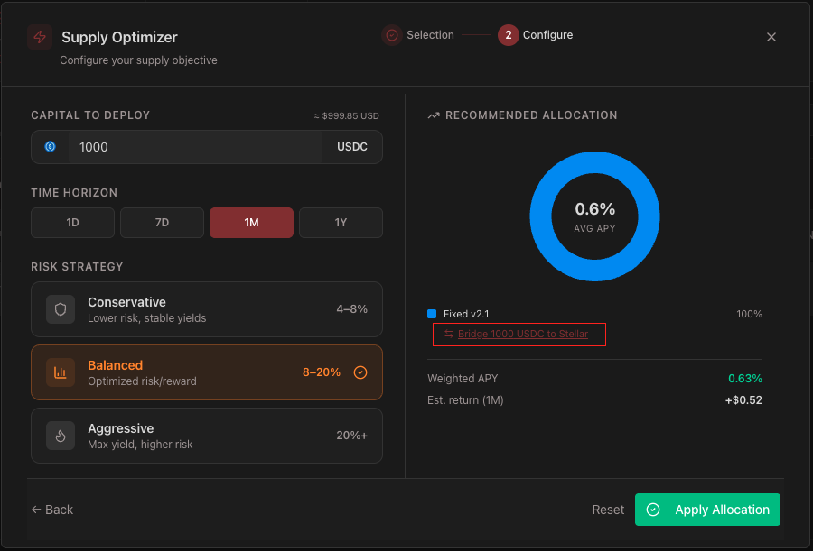

### Tests (CI)

| Test file                                                                                             | What it pins                                                                                                                                            |
| ----------------------------------------------------------------------------------------------------- | ------------------------------------------------------------------------------------------------------------------------------------------------------- |
| [`products/__tests__/ranking.test.ts`](../src/lib/products/__tests__/ranking.test.ts)                 | The fixture Stellar product ranked by its rate among the EVM markets of the same asset, first when it pays the most; tagged Stellar with a bridge entry |
| [`products/__tests__/bridge-entry.test.ts`](../src/lib/products/__tests__/bridge-entry.test.ts)       | Stellar USDC row → bridge with its product; EVM USDC row → its chain as source, only for a CCTP source chain; banner on the Stellar filter              |
| [`protocols/stellar/fixture/yield.test.ts`](../src/lib/protocols/stellar/fixture/yield.test.ts)       | The fixture is off without its variable and in production; one USDC supply product on the Blend v2.1 Fixed pool reserve                                 |
| [`execution/cctp/__tests__/deep-link.test.ts`](../src/lib/execution/cctp/__tests__/deep-link.test.ts) | Amount floored to 6 decimals; source only for a supported chain of the current network, no silent fallback                                              |

---

## 5 — Production monitoring & gap-heal extension

> **Success criteria:** A status report or monitoring screenshot provided with the submission shows
> the Stellar adapter family included in the same health checks as the other protocols, with gap
> detection and the Hubble refetch path exercised against a fixture Stellar adapter on staging,
> since this grant does not assume a live Stellar lending venue.

### What was built

| Proposal item                                                                                                       | Where                                                                                                             |
| ------------------------------------------------------------------------------------------------------------------- | ----------------------------------------------------------------------------------------------------------------- |
| **Families in the reconcile report**: adapters, gaps, repairs by refetch / neighbour, history calls — real outcomes | [`src/lib/reconcile/families.ts`](../src/lib/reconcile/families.ts), [`index.ts`](../src/lib/reconcile/index.ts)  |
| **Hubble refetch path** for Stellar adapters                                                                        | `getApyHistory` → [`fetchStellarHubbleHistory`](../src/lib/protocols/stellar/hubble-history.ts) (Tranche 1, 1.1b) |
| **Status report**                                                                                                   | [`scripts/reconcile-status.ts`](../scripts/reconcile-status.ts) (`pnpm reconcile:status`)                         |

### Staging: fixture adapter

On an isolated staging (a Neon branch copied from production, reset before the run), with
`STELLAR_YIELD_FIXTURE=1`: the fixture's availability was back-dated 72 hours and six hours of
Blend v2.1 were deleted from `apy_hourly`, then the reconcile ran. Setup, timeline and the cost of
the Hubble queries: [`scf-45/t3-reconcile.md`](scf-45/t3-reconcile.md).

| Report                   | Value                                  |
| ------------------------ | -------------------------------------- |
| `pipeline_reports` id    | `ed693236-26fe-4c19-9f0e-6c5572c752d4` |
| Run at                   | 2026-10-17 23:02:53 UTC                |
| Stellar gaps detected    | 78                                     |
| Repaired by refetch      | 78 (Hubble history, 2 queries)         |
| Repaired from neighbours | 0                                      |

```text
reconcile report ed693236-26fe-4c19-9f0e-6c5572c752d4 — 2026-10-17T23:02:53.573Z
window 2026-10-10T23:00:00.000Z → 2026-10-17T23:00:00.000Z · success true · dryRun false
family    gaps  refetch  neighbour  no donor  history req/ret/fail  adapters
evm          0        0          0         0                 0/0/0  aave_v3 (history), morpho_v1 (history), compound_v3 (history)
stellar     78       78          0         0                 2/2/0  blend_v2.1 (history), stellar_fixture (history)
```

The `families` section of the same report row:
[`scf-45/t3-reconcile-staging-families.json`](scf-45/t3-reconcile-staging-families.json).

### Production

The nightly reconcile on lendwise.fi checks the `stellar` family (Blend v2.1, history through
Hubble) in the same run as the EVM protocols; the fixture is not loaded in production. The first
production report with the family section, on the release `813b471`:

| Report                | Value                                                    |
| --------------------- | -------------------------------------------------------- |
| `pipeline_reports` id | `5437dd9a-ec08-4015-b845-5800e7774b5c`                   |
| Run at                | 2026-10-20 00:30:30 UTC (nightly schedule), 7-day window |
| `stellar` adapters    | `blend_v2.1`, with history; `stellar_fixture` absent     |
| `evm` adapters        | `aave_v3`, `morpho_v1`, `compound_v3`, with history      |
| Gaps                  | none that night in either family, so nothing to repair   |

```text
reconcile report 5437dd9a-ec08-4015-b845-5800e7774b5c — 2026-10-20T00:30:30.563Z
window 2026-10-13T00:00:00.000Z → 2026-10-20T00:00:00.000Z · success true · dryRun false
family    gaps  refetch  neighbour  no donor  history req/ret/fail  adapters
evm          0        0          0         0                 0/0/0  aave_v3 (history), morpho_v1 (history), compound_v3 (history)
stellar      0        0          0         0                 0/0/0  blend_v2.1 (history)
```

The `families` section of the same report row:
[`scf-45/t3-reconcile-production-families.json`](scf-45/t3-reconcile-production-families.json).
Production keeps the default 20 GiB cost cap on Hubble queries, so a Stellar hole there is
repaired from a neighbouring hour; the Hubble refetch path is the one exercised on staging above
(see [`scf-45/t3-reconcile.md`](scf-45/t3-reconcile.md#what-hubble-refetch-costs)).

### Tests (CI)

| Test file                                                                                 | What it pins                                                                                                                                                                          |
| ----------------------------------------------------------------------------------------- | ------------------------------------------------------------------------------------------------------------------------------------------------------------------------------------- |
| [`reconcile/__tests__/families.test.ts`](../src/lib/reconcile/__tests__/families.test.ts) | Family read from the chains an adapter declares; each family counted separately (Stellar refetched from Hubble, EVM healed by a neighbour); failed refetch and history calls reported |

---

## 6 — Public integration docs & final hardening pass

> **Success criteria:** Integration documentation is published and reachable at a public URL.

### Documentation

| Page                                                                                                               | Content                                                                                                                                  |
| ------------------------------------------------------------------------------------------------------------------ | ---------------------------------------------------------------------------------------------------------------------------------------- |
| [lendwise.fi/docs/integrate/stellar-lending-protocol](https://lendwise.fi/docs/integrate/stellar-lending-protocol) | The adapter contract: spot data source, Hubble history decode hook, positions and risk weights, registration, fixture                    |
| [lendwise.fi/docs/integrate/cctp-bridge](https://lendwise.fi/docs/integrate/cctp-bridge)                           | The CCTP integration architecture: contracts and domains, forwarder, decimals, trustline ordering, finality and fees, validation, resume |

### Hardening

Security review of the bridge's server actions before release (session, rate limit,
signed-transaction validation, server-side cap, no contract override from the environment,
generic client errors, foreign burn imports, state transitions, production network switch, paced
Iris calls). Its findings were fixed before the bridge shipped, in
[PR #34](https://github.com/lendwise-fi/lendwise/pull/34):

- the Stellar sign-in routes refuse cross-site requests;
- the client checks the burn's hook recipient against the account on screen before signing;
- per-IP limit on the bridge actions;
- Iris fee tiers cached 30 s, Iris queue bounded at 20;
- a burn replaced in the wallet is followed, and a lost one fails after 30 min;
- an expired attestation is refused;
- mint fee bid from the network's surge price, with the account's XLM checked against it;
- the EVM account is pinned between approval and burn.

After the first mainnet run: a signed mint the RPC provider does not answer is resent through the
public Soroban RPC ([PR #44](https://github.com/lendwise-fi/lendwise/pull/44)). Deployments were
hardened around the release: testnet, feature and fork previews run with their own database,
Redis, sign-in secrets and RPC keys (only the `mainnet` pre-production runs with production's);
fork deployments need a maintainer's approval; and [`SECURITY.md`](../SECURITY.md) puts the
Stellar sign-in and the bridge in scope for vulnerability reports.

### Mainnet QA on lendwise.fi

Run on 2026-10-19 (23:03–23:28 UTC), release `main` at `813b471`, with MetaMask and Freighter.

**First-time user** — fresh account
[`GDLZ2TS5XSMZ3WHO3R7TTJN56YUYHOBQRAX7SQZ4UHYNVXWCSIBBS7EG`](https://stellar.expert/explorer/public/account/GDLZ2TS5XSMZ3WHO3R7TTJN56YUYHOBQRAX7SQZ4UHYNVXWCSIBBS7EG),
3 XLM, no trustline:

| #   | Check                                           | Result                                                                |
| --- | ----------------------------------------------- | --------------------------------------------------------------------- |
| 1   | Stellar filter → bridge                         | OK                                                                    |
| 2   | Trustline prompt before the burn, burn disabled | OK: "Add USDC to your Stellar wallet", 0.5 XLM reserve                |
| 3   | ChangeTrust signed, preflight ready             | OK: "Bridge 5 USDC"                                                   |
| 4   | Approval and burn                               | OK: `approve` of 5 USDC to TokenMessengerV2, `depositForBurnWithHook` |
| 5   | Reload → resume, no second burn                 | OK: listed with **Resume** (already attested, Fast), one burn         |
| 6   | Mint, received amount = expected                | OK: 4.99935 USDC = (5,000,000 − 650) × 10 units                       |
| 7   | USDC in the portfolio and on Stellar Expert     | OK: 4.99935 USDC                                                      |

| Step        | Transaction                                                                                                             |
| ----------- | ----------------------------------------------------------------------------------------------------------------------- |
| ChangeTrust | [cdcb3006…](https://stellar.expert/explorer/public/tx/cdcb30066b6b9715abd179d903fa75a8e7f2994aa764a0747f08fef07189d3af) |
| Approval    | [0x377eba9b…](https://basescan.org/tx/0x377eba9b0f6092575c9fcbdceba607aa91aac45abfa1f534b13e11e7ac21e1c5)               |
| Burn        | [0x21deba50…](https://basescan.org/tx/0x21deba50dfd285d1dcad86e798a9bc95d4bd70074da224b3a52c7745dba7e506)               |
| Mint        | [14cd5da6…](https://stellar.expert/explorer/public/tx/14cd5da6b70d8a1f078a1fe05b949f3e288d0ebab0553bffbe23996c9396fbf0) |

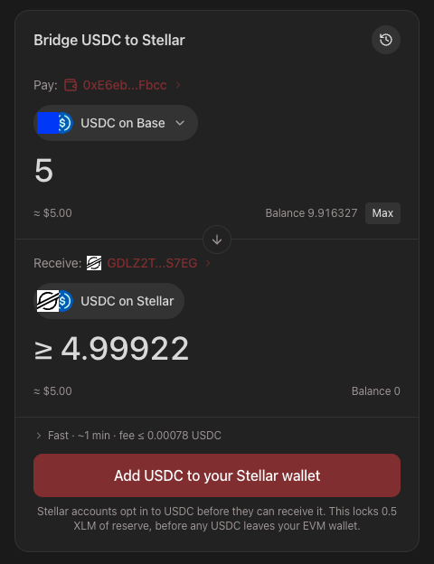

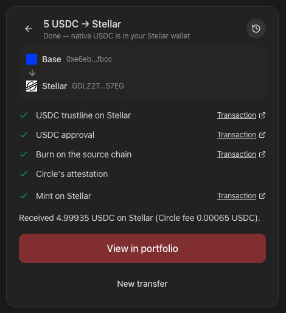

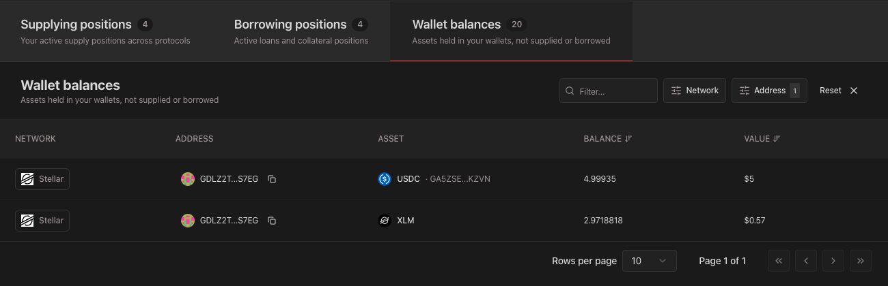

**Returning user** — account
[`GDHYIHAZ5URVB5TUKLREMPFGH4AYMIMON5KHXKKNYLTYGLUECF4OKV33`](https://stellar.expert/explorer/public/account/GDHYIHAZ5URVB5TUKLREMPFGH4AYMIMON5KHXKKNYLTYGLUECF4OKV33),
existing trustline:

| #   | Check                                               | Result                                                                                                                    |
| --- | --------------------------------------------------- | ------------------------------------------------------------------------------------------------------------------------- |
| 1   | USDC row on Base → bridge with Base pre-selected    | OK: Pay "USDC on Base"                                                                                                    |
| 2   | Blend USDC row → bridge with the product, no source | OK: the link carries `product=`, and the page resolves the next step to Blend                                             |
| 3   | Optimizer allocation on Stellar → bridge link       | OK: Blend v2.1 Fixed at 100 %, "Bridge 1000 USDC to Stellar"                                                              |
| 4   | Preflight ready, no ChangeTrust                     | OK: "Bridge 4 USDC" directly                                                                                              |
| 5   | Full transfer                                       | OK: 3.99948 USDC = (4,000,000 − 520) × 10 units                                                                           |
| 6   | Transfers list                                      | OK: this account's transfers, newest first, with the mint link                                                            |
| 7   | Amount above the 1,000 USDC cap                     | OK: refused before any wallet call; the server-side cap is pinned in `service.test.ts`; no row above the cap in the table |
| 8   | Malformed amounts (`1,5`, `0.0000001`)              | OK: refused before any wallet call                                                                                        |
| 9   | Signed out                                          | OK: back to "Sign in with Stellar", transfers list disabled                                                               |

| Step     | Transaction                                                                                                             |
| -------- | ----------------------------------------------------------------------------------------------------------------------- |
| Approval | [0xad3aafc4…](https://basescan.org/tx/0xad3aafc4617b215253822a89bd3646e5eb322e74d75f8ced4ccf6818625c907a)               |
| Burn     | [0x2e3be76a…](https://basescan.org/tx/0x2e3be76ab76e4544adb7046962d64825e9ea53c45bf71477268b73fc5d30d9ac)               |
| Mint     | [a6e39a07…](https://stellar.expert/explorer/public/tx/a6e39a07754dd1cdccc2d0a6428f9efdad787bbc25c6dc6651962c57aa563154) |


The returning user's burn was relayed by MetaMask, which paid the gas in USDC: on Basescan the
transaction is sent by a MetaMask relayer, and the `DepositForBurn` event names the user as
depositor. The server checks the burn against that depositor, so it accepted it.

## Related

- [Milestone 1 evidence](scf-45-milestone-1.md)
- [Milestone 2 evidence](scf-45-milestone-2.md)
- [Architecture of the Stellar integration](architecture-stellar-integration.md)
